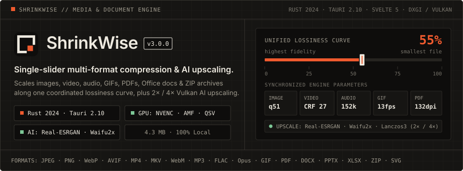
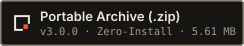
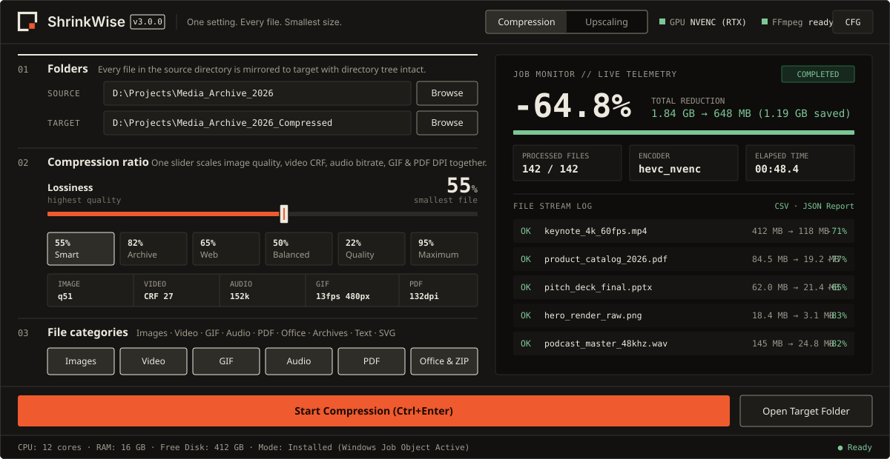
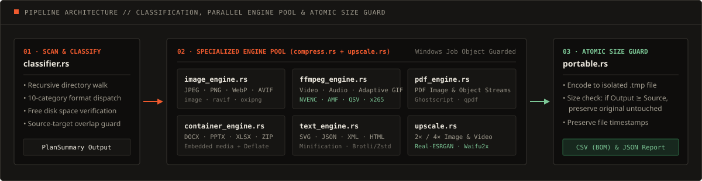

<div align="center">
  

  <br />
  <br />

  <p>
    <a href="https://github.com/ravion-dev/shrinkwise/releases/download/v3.0.0/ShrinkWise_3.0.0_x64-setup.exe"></a>&nbsp;&nbsp;<a href="https://github.com/ravion-dev/shrinkwise/releases/download/v3.0.0/ShrinkWise_3.0.0_x64-portable.zip"></a>
  </p>

  <p>
    <a href="https://github.com/ravion-dev/shrinkwise/releases/tag/v3.0.0"></a>
    
    
    
    
    <a href="https://buymeacoffee.com/ravion_dev"></a>
  </p>
</div>

---

**ShrinkWise** is a native Windows desktop utility built with **Rust (2024 Edition)**, **Tauri 2**, and **Svelte 5**. It replaces fragmented media encoders, PDF compressors, and archive repackers with a single coordinated **lossiness curve (0–100%)** and a hardware-accelerated **AI media upscaling pipeline** (`Real-ESRGAN`, `Waifu2x` NCNN Vulkan, and native Rust `Lanczos3`).

All processing runs 100% locally on your hardware with atomic output protection: source files are never modified in place, and if a re-encoded output equals or exceeds the original byte count, ShrinkWise discards the candidate and preserves the original untouched.

<br />



---

## Core Engineering Highlights

- **Unified Single-Slider Scaling** — One continuous lossiness setting (`0–100%`) simultaneously derives image quantization quality, H.264/HEVC video `CRF`/`QP`, audio bitrate, GIF frame rate and palette density, and PDF embedded image `DPI`.
- **AI & Lanczos3 Media Upscaling** — Upscales images and video streams by `2×` or `4×` using `Real-ESRGAN` and `Waifu2x` over NCNN Vulkan, with zero-dependency fallback to an in-process Rust `Lanczos3` resampler when external Vulkan binaries are not installed.
- **DXGI Hardware Probing & GPU Encoding** — Enumerates NVIDIA, AMD, and Intel adapters via DXGI and validates `NVENC`, `AMF`, and `QSV` hardware encoders by encoding a real test frame before batch execution, falling back cleanly to `libx264` / `libx265`.
- **One-Click Verified Toolchain** — Downloads and verifies (`SHA-256`) external binaries (`FFmpeg`, `7-Zip`, `Ghostscript`, `qpdf`, `realesrgan-ncnn-vulkan`, `waifu2x-ncnn-vulkan`) directly into `tools/bin` from inside the Settings view.
- **Atomic Size Guard & Process Containment** — Encodes to isolated temporary files first, enforces strict size-reduction checks, preserves filesystem timestamps on request, and binds all child worker processes to a Windows **Job Object** (`JOB_OBJECT_LIMIT_KILL_ON_JOB_CLOSE`) so no orphaned `ffmpeg` processes survive termination.
- **Dual Deployment Modes** — Ships both as a signed-ready **Windows NSIS Installer** (`setup.exe` + `uninstall.exe` registered in Windows Settings and Control Panel) and as a self-contained **Portable** directory that keeps `settings.json`, `tools/bin`, `logs/`, and `temp/` alongside the executable.

---

## Processing Pipeline & Format Matrix



<br />

| Category | Extensions | Processing Engine | Strategy |
| :--- | :--- | :--- | :--- |
| **Images** | `jpg`, `jpeg`, `png`, `webp`, `avif`, `bmp`, `tiff` | Native Rust (`image`, `ravif`, `oxipng`) | Perceptual quantization scaling, metadata/EXIF stripping, lossless PNG optimization, optional format transcoding |
| **Video** | `mp4`, `mkv`, `mov`, `webm`, `avi`, `m4v`, `wmv`, `flv` | FFmpeg (`NVENC`, `AMF`, `QSV`, `libx264`, `libx265`, `VP9`, `AV1`) | Hardware or software CRF/QP curve mapping, optional resolution cap and audio track pass-through or re-encode |
| **Audio** | `mp3`, `flac`, `wav`, `ogg`, `aac`, `m4a`, `opus`, `wma` | FFmpeg (`libopus`, `aac`, `libmp3lame`, `flac`) | Bitrate scaling (`64–256 kbps`) in lossy mode or maximum-compression FLAC in lossless mode |
| **Animated GIF** | `gif` | FFmpeg (`palettegen` + `paletteuse`) | Two-pass adaptive palette generation (`32–256` colors), frame rate scaling (`8–20 fps`), and bounding-width clamping |
| **PDF Documents** | `pdf` | `Ghostscript` + `qpdf` | Embedded raster downsampling (`72–220 DPI`) in lossy mode; object-stream compression (`qpdf --object-streams=generate`) in lossless mode |
| **Office & Containers** | `docx`, `pptx`, `xlsx`, `odt`, `odp`, `ods`, `epub`, `cbz`, `zip` | Native Rust Container Engine (`zip` + `image_engine`) | Recursively inspects archive entries, compresses embedded raster media in memory, and repacks with optimal Deflate compression |
| **Text & Vector** | `svg`, `json`, `xml`, `html`, `css`, `js`, `ts`, `csv`, `md`, `txt` | Native Rust (`text_engine` + `Brotli` / `Zstd` / `XZ` / `Gzip`) | Safe whitespace/comment minification for structured text and SVG, plus optional sidecar stream compression |
| **Media Upscaling** | `png`, `jpg`, `webp`, `bmp`, `mp4`, `mkv`, `mov`, `webm`, `gif` | `Real-ESRGAN`, `Waifu2x` (NCNN Vulkan) & Native Rust `Lanczos3` | `2×` / `4×` neural super-resolution or Lanczos3 resampling with frame-by-frame video pipeline and audio muxing |

---

## Single-Slider Preset Reference

| Preset | Lossiness | Image Quality | Video CRF | Audio Bitrate | GIF Output | PDF Downsampling |
| :--- | :---: | :---: | :---: | :---: | :---: | :---: |
| **Quality** | `22%` | `q76` | `CRF 22` | `214 kbps` | `17 fps · 640 px` | `185 DPI` |
| **Balanced** | `50%` | `q55` | `CRF 26` | `160 kbps` | `14 fps · 480 px` | `140 DPI` |
| **Smart (Default)** | `55%` | `q51` | `CRF 27` | `152 kbps` | `13 fps · 480 px` | `132 DPI` |
| **Web** | `65%` | `q43` | `CRF 29` | `132 kbps` | `12 fps · 480 px` | `116 DPI` |
| **Archive** | `82%` | `q31` | `CRF 32` | `100 kbps` | `10 fps · 360 px` | `89 DPI` |
| **Maximum** | `95%` | `q21` | `CRF 34` | `76 kbps` | `9 fps · 360 px` | `72 DPI` |

> Enabling **Lossless Mode** overrides the lossiness curve across all engines: PNGs are optimized bit-identically via `oxipng`, videos use lossless quantizers, audio encodes to FLAC, PDFs run structural object-stream compaction via `qpdf`, and containers repack without lossy media re-encoding.

---

## Installation & Verification

Download the latest binaries from the [Releases](https://github.com/ravion-dev/shrinkwise/releases/tag/v3.0.0) page:

1. **Windows NSIS Installer (`ShrinkWise_3.0.0_x64-setup.exe` — 4.32 MB)**
   Supports per-user (`%LOCALAPPDATA%\ShrinkWise`) and per-machine (`C:\Program Files\ShrinkWise`) installation, Start Menu / Desktop shortcuts, and uninstallation via **Windows Settings > Installed Apps** or **Control Panel > Programs and Features**.
2. **Portable Archive (`ShrinkWise_3.0.0_x64-portable.zip` — 5.61 MB)**
   Extract anywhere and run `ShrinkWise.exe`. No registry entries or `%APPDATA%` footprints are created when run from a writable folder.

### SHA-256 Checksums (`v3.0.0`)

```text
EC997BFB654DDF386CA17E738DB533AF53C0737D5C91E56DD3F003D29BD8FC10  ShrinkWise_3.0.0_x64-setup.exe
CEF008E255D8E9DF5FA7EAB8A29C0422D2D1998A41841AEDC2BA7FF656B1CCD0  ShrinkWise_3.0.0_x64-portable.zip
```

---

## Building from Source

### Prerequisites

- **OS:** Windows 10 or Windows 11 (`x64`)
- **Rust:** `1.85+` (`x86_64-pc-windows-msvc`, Edition 2024)
- **Node.js:** `20+`
- **C++ Toolchain:** Visual Studio Build Tools (Desktop development with C++)

### Development & Static Analysis

```powershell
# Install frontend dependencies
npm install

# Launch desktop development window with hot reload
npm run tauri dev

# Frontend type & Svelte 5 rune check
npm run check
npm run build

# Rust formatting, strict Clippy lints, and unit tests
cd src-tauri
cargo fmt -- --check
cargo clippy --all-targets -- -D warnings
cargo test
```

### Packaging Distributables

```powershell
# Build Windows NSIS Installer (outputs to dist-installer\ShrinkWise_3.0.0_x64-setup.exe)
.\scripts\build-installer.ps1

# Build Portable directory & ZIP archive (outputs to dist-portable\ShrinkWise-portable.zip)
.\scripts\build-portable.ps1 -IncludeTools -Zip
```

---

## Repository Layout

```text
shrinkwise-rs/
├── .github/assets/                 Vector hero banner, console UI plate, and pipeline diagrams
├── scripts/
│   ├── build-installer.ps1         Windows NSIS installer & uninstaller build script
│   └── build-portable.ps1          Standalone portable directory & ZIP packager
├── src/                            Svelte 5 + TypeScript frontend
│   ├── lib/components/             Precision industrial UI primitives (Icon, Toggle, Slider, Accordion)
│   ├── lib/views/Settings.svelte   Hardware diagnostics, benchmark, and one-click tool manager
│   ├── lib/views/Upscaling.svelte  Real-ESRGAN, Waifu2x & Lanczos3 upscaling workspace
│   ├── lib/i18n.ts                 Bilingual localization dictionary (English & Turkish)
│   └── lib/types.ts                Backend contracts, presets, and unified plan computation
└── src-tauri/                      Rust 2024 + Tauri 2 core
    ├── windows/hooks.nsh           NSIS install/uninstall hooks and Windows registry integration
    └── src/
        ├── classifier.rs           Directory scanner and 10-category format classifier
        ├── commands.rs             Tauri IPC command handlers
        ├── compress.rs             Parallel batch coordinator, telemetry events, CSV/JSON reports
        ├── container_engine.rs     OOXML (DOCX/PPTX/XLSX), ODF, EPUB, CBZ, and ZIP repacker
        ├── ffmpeg_engine.rs        Video, audio, and two-pass adaptive GIF pipeline
        ├── image_engine.rs         Native Rust JPEG, PNG, WebP, AVIF, BMP, and TIFF encoder
        ├── pdf_engine.rs           Ghostscript & qpdf document optimizer
        ├── portable.rs             Portable/installed path resolution and Windows Job Object guard
        ├── settings.rs             Persistent configuration schema and defaults
        ├── system.rs               CPU/RAM telemetry, DXGI GPU enumeration, and encoder benchmark
        ├── text_engine.rs          SVG/JSON/XML/HTML/CSS/JS minifier and Brotli/Zstd/XZ compressor
        ├── tools.rs                SHA-256 verified downloader for external binaries
        └── upscale.rs              NCNN Vulkan AI super-resolution and Lanczos3 resampler
```

---

## Support the Project

If ShrinkWise saves you time and storage, consider supporting its development:

<div align="center">
  <a href="https://buymeacoffee.com/ravion_dev"></a>
</div>
